# Laporan Uji Testcase — Aku Mw Magang

- **Tanggal uji:** 26 November 2026
- **Lingkungan:** Chrome (desktop), `npm run dev` (Vite), localStorage dikosongkan sebelum uji
- **Commit yang diuji:** `main` setelah PR #29, ditambah perbaikan kecil di PR ini
- **Pembagian:** Wawa (TC 1, 2, 3, 9), Alin (TC 4, 8, 10 Comparator), Hendra (TC 5, 6, 7, 10 Undo)

## Ringkasan

| No | Skenario | Hasil |
|---|---|---|
| 1 | Fetch & Offline Error | ✅ Lulus |
| 2 | Skill Match Live | ✅ Lulus |
| 3 | Debounce Search | ✅ Lulus |
| 4 | Anti-Duplikat & Focus | ✅ Lulus |
| 5 | State Machine | ✅ Lulus |
| 6 | Simulasi Ghosting | ✅ Lulus |
| 7 | Bentrok Interview | ✅ Lulus |
| 8 | Checklist & Refresh | ✅ Lulus |
| 9 | Timer Cleanup | ✅ Lulus |
| 10 | Undo & Comparator | ✅ Lulus |

Tambahan: `npx tsc --noEmit`, `npm run build`, dan `npm run lint` lolos; tidak ada error di console selama pengujian.

---

## TC 1 — Fetch & Offline Error

**Langkah**
1. Buka tab Eksplorasi → muncul Loading lalu daftar lowongan dari Remotive API (16 lowongan).
2. Putus koneksi ke API (Offline), klik **↻ Muat Ulang**.
3. Klik **Pakai Fallback Lokal**.

**Hasil**
- Loading tampil, lalu muncul state Error: *"Tidak bisa terhubung ke server. Periksa koneksi internet kamu."* dengan tombol **Coba Lagi** dan **Pakai Fallback Lokal**.
- Fallback memuat 15 lowongan dari `magang-fallback.json`.

> Catatan: offline disimulasikan dengan membuat request ke `remotive.com` gagal (`TypeError: Failed to fetch`), sama seperti saat jaringan putus. Mode *Offline* DevTools juga memblokir request ke dev server lokal, jadi fallback paling baik dicoba setelah koneksi kembali atau saat hanya API eksternal yang gagal.

| Remotive | Loading | Error offline | Fallback lokal |
|---|---|---|---|
| 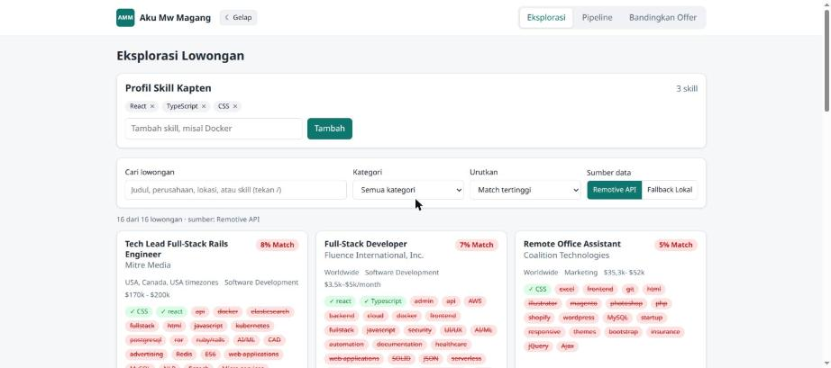 | 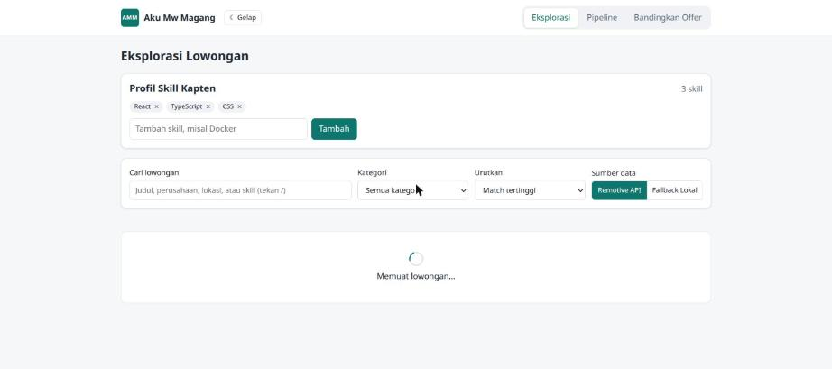 | 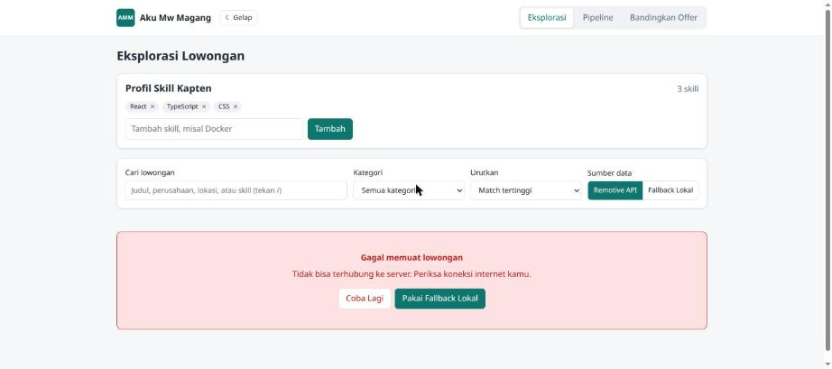 | 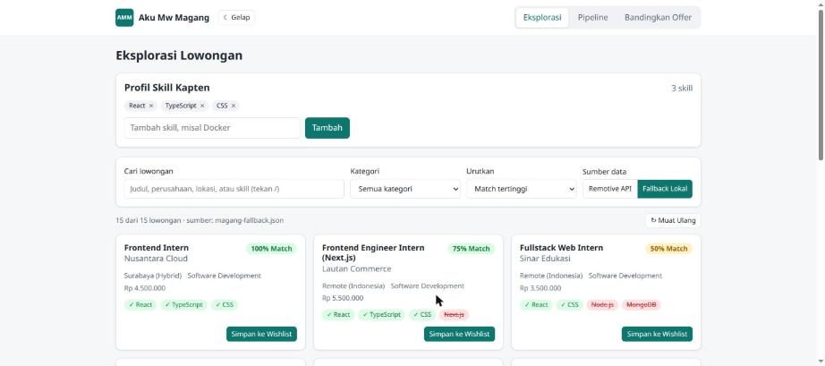 |

## TC 2 — Skill Match Live

**Langkah:** Tambah skill **Docker** di Profil Skill Kapten.

**Hasil:** Match lowongan yang meminta Docker langsung naik tanpa reload:

| Lowongan | Sebelum | Sesudah |
|---|---|---|
| Backend Engineer Intern | 25% | 50% |
| DevOps Intern | 0% | 25% |
| Machine Learning Intern | 0% | 25% |
| Golang Backend Intern | 0% | 25% |

Menambah `DOCKER` lagi ditolak: *Skill "DOCKER" sudah ada*.

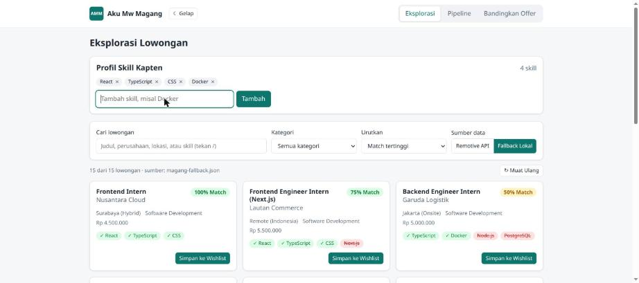

## TC 3 — Debounce Search

**Langkah:** Ketik cepat `golang` (6 ketukan dalam ±12 ms) di kolom pencarian.

**Hasil:** Daftar hanya berubah **1 kali**, **±404 ms** setelah ketukan terakhir (15 → 1 lowongan). Selama jeda muncul indikator "mencari…".

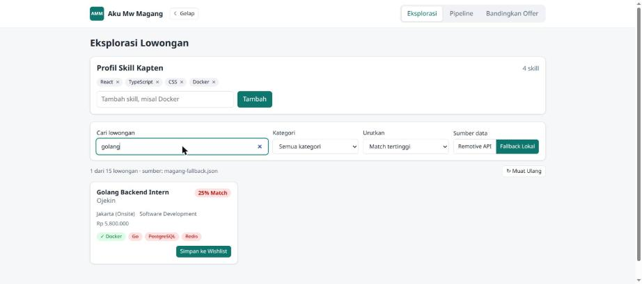

## TC 4 — Anti-Duplikat & Focus

**Langkah**
1. Simpan lowongan *Frontend Intern — Nusantara Cloud* ke Wishlist.
2. Di Form Manual isi `nusantara cloud` / `frontend intern` (huruf kecil), kursor di field Required Skills, lalu klik Tambah Lamaran.

**Hasil**
- Tombol berubah jadi **Sudah Dilamar** (disabled).
- Form menolak: *"Lamaran nusantara cloud — frontend intern sudah ada"*; fokus otomatis pindah ke input **Perusahaan** (`useRef`). Jumlah lamaran tetap 1.

| Sudah Dilamar | Duplikat ditolak + fokus |
|---|---|
| 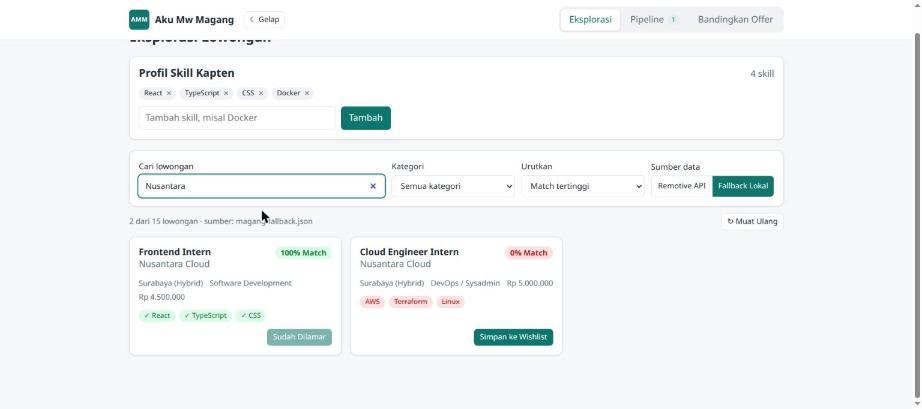 | 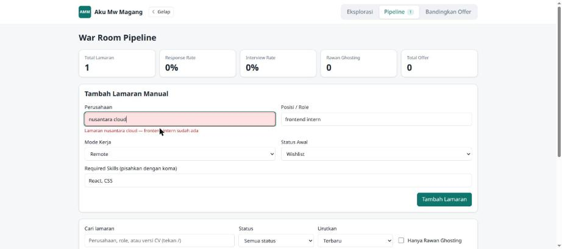 |

## TC 5 — State Machine

**Langkah:** Pada *Nusantara Cloud* (WISHLIST): pindah ke APPLIED → SCREENING → INTERVIEW.

**Hasil**
- Dari WISHLIST, opsi tujuan hanya **Applied**; OFFER tidak tersedia (tidak bisa dipilih).
- APPLIED tanpa data ditolak: *Versi CV wajib diisi*, *Tanggal melamar wajib diisi*. Setelah diisi (`CV-v2-frontend`, `2026-11-20`) berhasil.
- INTERVIEW tanpa jadwal ditolak: *Jadwal interview wajib diisi*. Setelah diisi `2026-12-01T10:00` berhasil.
- Dari INTERVIEW opsi berikutnya: Offer, Rejected, Ghosted.
- Activity log mencatat setiap perpindahan status.

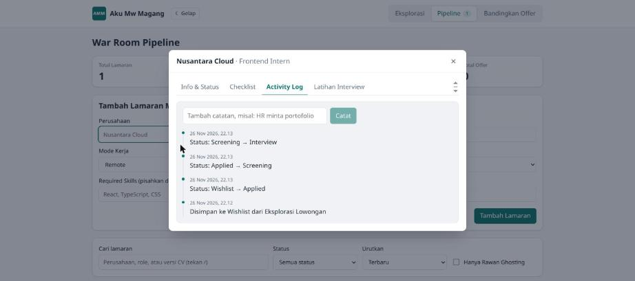

## TC 6 — Simulasi Ghosting

**Langkah:** Tambah *Arunika Data — Data Engineer Intern* (APPLIED), klik **Simulasi +15 Hari**.

**Hasil:** Badge **Rawan Ghosting** muncul, kartu statistik Rawan Ghosting naik **0 → 1**, dan toggle *Hanya Rawan Ghosting* hanya menampilkan Arunika Data.

| Statistik | Badge |
|---|---|
| 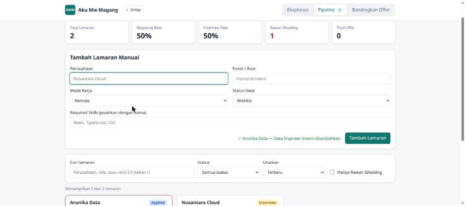 | 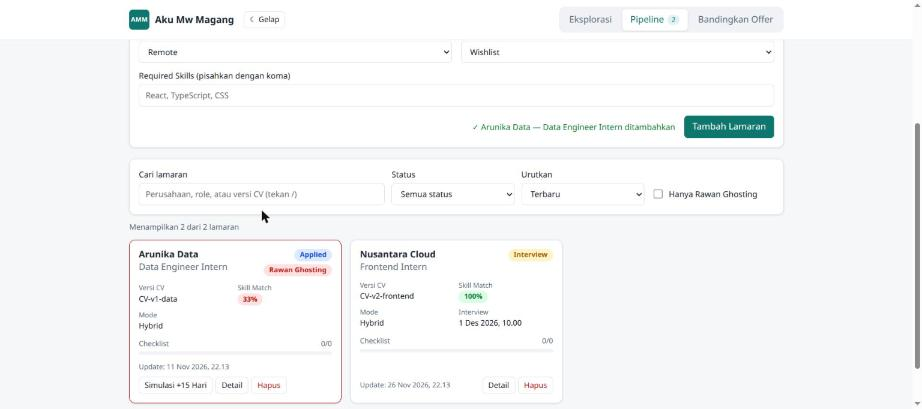 |

## TC 7 — Bentrok Interview

**Langkah:** Pindahkan Arunika Data ke INTERVIEW `2026-12-01T10:30` (Nusantara Cloud `10:00`), lalu set filter status **Wishlist**.

**Hasil:** Banner *"Jadwal interview bentrok (1) — Arunika Data (10.30) dan Nusantara Cloud (10.00) hanya berselisih 30 menit"* tampil, dan **tetap tampil** saat filter Wishlist aktif (0 kartu tampil).

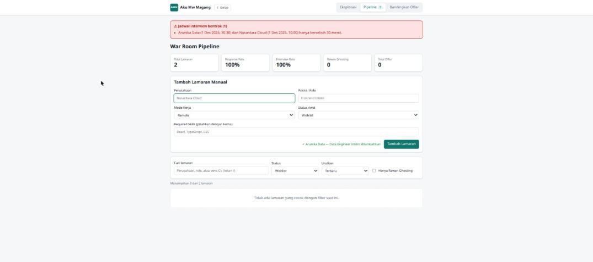

## TC 8 — Checklist & Refresh

**Langkah:** Tambah 2 checklist pada Nusantara Cloud, centang 1, lalu refresh (F5).

**Hasil:** Progress **1/2 (50%)**. Setelah refresh, isi `localStorage` identik dengan sebelum refresh; kartu & detail tetap menunjukkan 1/2, skill Kapten (termasuk Docker) tetap ada.

| Sebelum refresh | Setelah refresh |
|---|---|
| 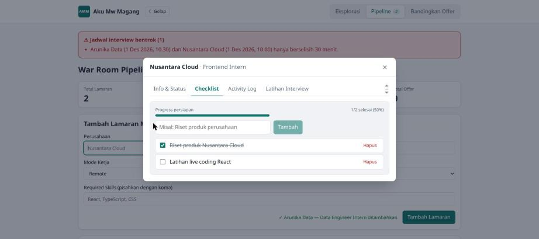 | 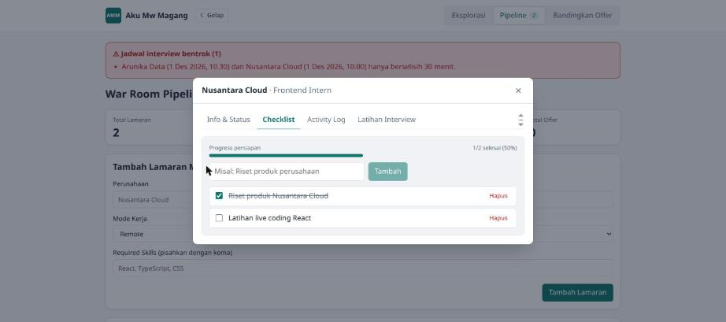 |

## TC 9 — Timer Cleanup

**Langkah:** Start Prep Timer (±3 detik → 01:57), tutup modal, tunggu 1,5 detik, buka lagi lalu Start.

**Hasil:** Saat dibuka ulang timer kembali 02:00. Dalam 5 detik timer turun tepat **5 detik** (02:00 → 01:55), tidak 2x cepat. Pause menghentikan hitungan. Tidak ada error console.

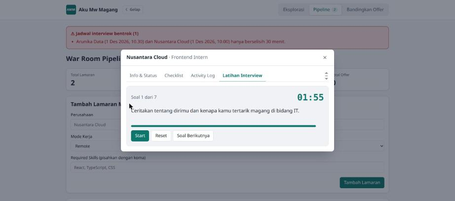

## TC 10 — Undo & Comparator

**Undo**
- Hapus Nusantara Cloud → toast *"Lamaran Nusantara Cloud dihapus — UNDO"*. Klik Undo < 5 detik → data kembali **identik** (2 checklist, 4 activity log, posisi semula), banner bentrok muncul lagi.
- Hapus 2x berturut-turut (Temp Corp A, 3 detik kemudian Temp Corp B): toast masih tampil di detik ke-5,9 (timer lama sudah di-`clearTimeout`) dan baru hilang ±5 detik setelah hapus kedua.

**Comparator**
- Sebelum ada offer: pesan *"Butuh minimal 2 lamaran berstatus Offer…"*.
- OFFER tanpa nominal ditolak: *Nominal offer harus lebih dari 0*.
- Nusantara Cloud → OFFER Rp 4.500.000 Hybrid; Arunika Data → OFFER Rp 6.000.000 Remote.

| Kriteria | Arunika Data | Nusantara Cloud |
|---|---|---|
| Gaji | Rp 6.000.000 | Rp 4.500.000 |
| Skor Gaji (50%) | 100 × 0,5 = 50,0 | 75 × 0,5 = 37,5 |
| Skor Mode (25%) | Remote 100 × 0,25 = 25,0 | Hybrid 75 × 0,25 = 18,8 |
| Skor Skill (25%) | 33% × 0,25 = 8,3 | 100% × 0,25 = 25,0 |
| **Total** | **83,3** — Rekomendasi Terbaik | 81,3 |

Hasil aplikasi sama dengan hitungan manual.

| Toast Undo | Offer Comparator |
|---|---|
| 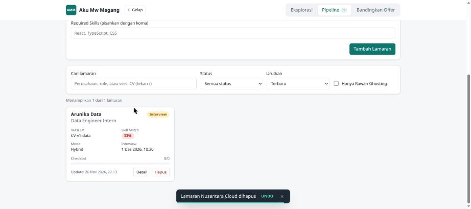 | 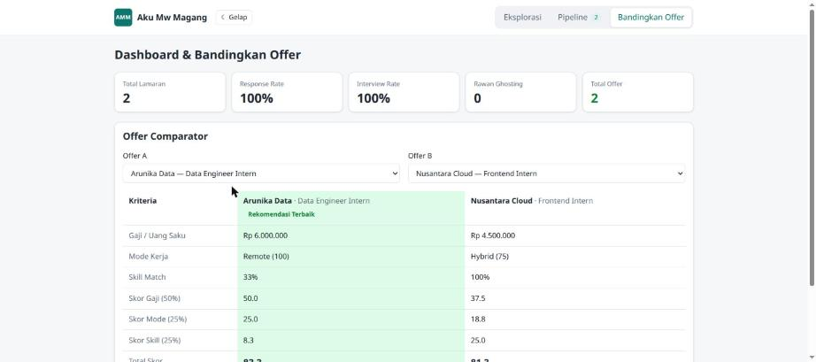 |

---

## Perbaikan yang ditemukan saat uji

1. **TC 1:** setelah lowongan berhasil dimuat tidak ada tombol untuk fetch ulang, padahal skenario meminta Offline lalu *Retry*. Ditambahkan tombol **↻ Muat Ulang** di atas daftar lowongan.
2. Sub-tab modal Detail Lamaran memunculkan scrollbar vertikal kecil; diperbaiki dengan `overflow-y: hidden`.
